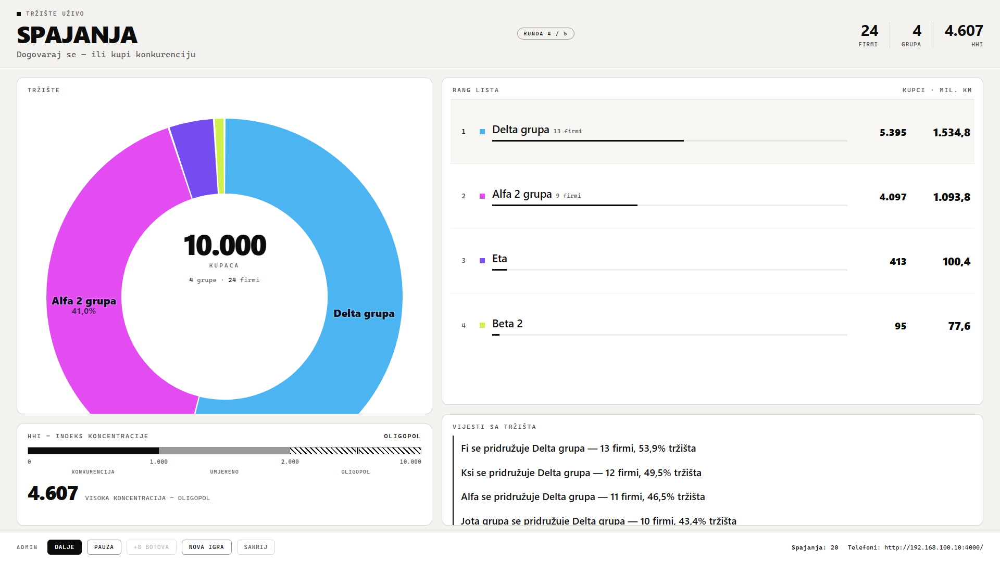
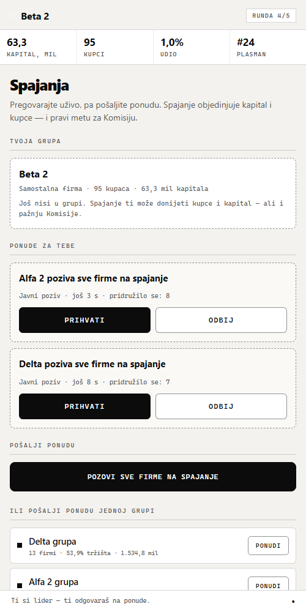
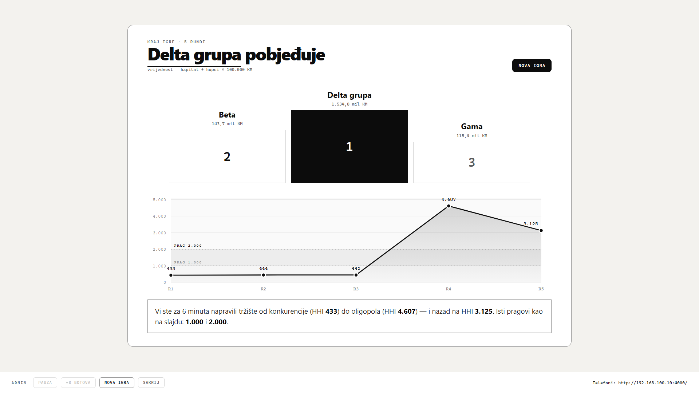

# TRŽIŠTE UŽIVO

**🔗 Uživo (Vercel):** [trziste-uzivo.vercel.app/screen](https://trziste-uzivo.vercel.app/screen) ·
telefoni: [trziste-uzivo.vercel.app](https://trziste-uzivo.vercel.app/)

[](https://render.com/deploy?repo=https://github.com/sergejzecevicsales-gif/Integracije-igra)

Multiplayer igra za predavanje o tržišnim strukturama, konkurenciji i koncentraciji.
Studenti osnivaju firme na telefonima i 6–7 minuta igraju na tržištu od **10.000 kupaca**,
a profesor na projektoru gleda kako tržište klizi iz konkurencije u oligopol — i nazad.

* **Projektor / računar:** veliki ekran sa tržištem, HHI mjeračem, rang listom i vijestima
* **Telefoni:** svaki student vodi svoju firmu (5 rundi)
* **Bez instalacije i bez baze za lokalnu igru** — jedan Node.js fajl i statični frontend
* **Online:** Vercel + Neon Postgres (serverless, polling) — link radi sa bilo koje mreže
* **Demo režim:** dugme „+8 botova“ popuni salu ako nema dovoljno telefona

---

## 1. Brzo pokretanje

1. Instaliraj [Node.js](https://nodejs.org) (LTS). Provjera: `node -v`
2. Dvoklik na **`start.bat`** (ili `npm start`)
3. Otvoriće se ekran za projektor: **`http://localhost:4000/screen`**
4. Na projektoru piše adresa za telefone (npr. `http://192.168.100.10:4000/`) i QR kod
5. Studenti otvore tu adresu, upišu ime firme i kliknu **OSNUJ FIRMU**
6. Kad se svi prijave: **POKRENI IGRU**

> Ako je port 4000 zauzet, server sam prelazi na 4001, 4002… i na ekranu prikaže tačnu adresu.
> Port možeš fiksirati: `set PORT=4100 && node server.js`

### Mreža (najčešći problem)

* Računar i telefoni moraju biti na **istoj Wi-Fi mreži**.
* Prvi put Windows pita za dozvolu firewall-a — klikni **Allow access** (Private networks).
* Ako telefoni ne mogu da se spoje: provjeri firewall, isključi **AP/client isolation**
  na ruteru, isključi VPN, ili napravi hotspot sa telefona i poveži računar na njega.
* Provjera sa telefona: otvori adresu sa ekrana — ako vidiš formu za prijavu, sve radi.

---

## 2. Kako izgleda čas (6–7 minuta)

| Faza | Trajanje | Šta studenti rade | Šta piše na projektoru |
|---|---|---|---|
| Lobi | dok se svi ne prijave | upisuju ime firme | adresa, QR, lista firmi |
| **R1 Borba za kupce** | **25 s (tajmer)** | tapkaju i otimaju kupce | krug se dijeli na 30 komada, HHI ~330 |
| **R2 Cjenovni rat** | ručno | biraju nisku/srednju/visoku cijenu | HHI blago raste, priča o zatvorenikovoj dilemi |
| **R3 Investicije** | ručno | reklama / inovacija / štednja | otkriva se čije su inovacije uspjele |
| **R4 Spajanja** | ručno | zovu, pregovaraju, spajaju se | krug se skuplja u par velikih komada, **HHI u crveno** |
| **R5 Komisija** | ručno | glasaju koju grupu zabraniti | raspad grupe, **HHI pada nazad** |
| Kraj | — | gledaju finale | pobjedničko postolje + graf HHI kroz igru |

**Tajmer ima samo runda tapkanja (R1).** Sve ostale runde, kao i svaki ekran sa rezultatima,
profesor zatvara i otvara ručno dugmetom **DALJE** (i `Space`) — tako ima vremena za objašnjenje.
`PAUZA` zamrzava igru (i tajmer u R1) kad je potrebno.

---

## 3. Pravila po rundama

### Runda 1 — Borba za kupce (25 s)

Svako tapkanje je dio tržišta. Na kraju runde kupci se dijele srazmjerno broju tapkanja
(+ mali bazni udio da niko ne ostane na nuli). 10.000 kupaca, 30 firmi → HHI ≈ 330.

### Runda 2 — Cjenovni rat (ručno)

| Cijena | Zarada po kupcu | Privlačnost kupaca |
|---|---|---|
| **Niska** | 8.000 KM | +70% |
| **Srednja** | 20.000 KM | 0% |
| **Visoka** | 55.000 KM | −38% |

Kupci se preraspodjeljuju prema cijeni (oni sa niskom cijenom uzimaju dio onima sa visokom).
Zamka: **ako svi obore cijenu, niko ne dobija kupce**, a svi zarađuju manje.
Ako svi drže visoku cijenu, svi zarađuju — ali svako pojedinačno ima motiv da obori cijenu.

### Runda 3 — Investicije (ručno)

| Ulaganje | Cijena | Efekat |
|---|---|---|
| **Reklama** | 15 mil | +30% kupaca (na račun drugih) |
| **Inovacija** | 20 mil | 40% šanse da udvostručiš kupce; ako ne uspije, uloženih 20 mil je izgubljeno |
| **Štednja** | 0 | +8 mil kapitala, bez rizika |

Trošak se odbija odmah; ishod inovacije se otkriva na projektoru na kraju runde.

### Runda 4 — Spajanja (ručno)

* **Direktna ponuda** — pošalješ ponudu jednoj grupi; ona prihvata/odbija (12 s).
* **Javni poziv** — pozoveš sve firme; svaka grupa koja prihvati pridružuje se tvojoj (20 s).
  Tako nastaju velike grupe u nekoliko sekundi — zato HHI skače u crveno.
* Grupe se mogu spajati dalje. **Samo lider grupe** šalje i prihvata ponude.
* Spajanje objedinjuje kapital i kupce. Lider ostaje onaj ko je inicirao spajanje.

### Runda 5 — Komisija (ručno)

* Glasa svaka firma, jedan glas, **ne može se glasati za svoju grupu**.
* Na glasačkom listiću su **4 najveće grupe**; zabranjuje se ona sa najviše glasova.
* Zabranjena grupa se **raspada na firme kakve su bile prije spajanja** i plaća kaznu
  od **30% kapitala**.
* Ako jedna grupa drži **više od 60% tržišta**, Komisija je raspada po službenoj dužnosti
  (da priča uvijek ima poentu — tako je i u stvarnoj politici konkurencije).

### Kraj

**Vrijednost firme = kapital + kupci × 100.000 KM.** Pobjednik je grupa sa najvećom
vrijednošću. Na projektoru se prikaže postolje i graf HHI kroz svih 5 rundi, sa pragovima
**1.000** i **2.000** — ista skala kao na slajdu: *„Za 6 minuta napravili ste tržište
od konkurencije do oligopola, i nazad.“*

---

## 4. Admin ekran (`/screen`)

Dugmad u donjoj traci:

| Dugme | Šta radi |
|---|---|
| **POKRENI / DALJE** | pokreće igru / preskače trenutnu fazu |
| **PAUZA** | zamrzava igru (i tajmer u R1) dok pričaš |
| **+8 BOTOVA** | dodaje demo firme u lobiju (samo u lobiju) |
| **NOVA IGRA** | resetuje rezultate, zadržava firme (za ponovno igranje iste grupe) |
| **SAKRIJ** | sklanja admin traku sa projektora |

Prečice na tastaturi: `Space` = dalje · `P` = pauza · `B` = botovi · `R` = nova igra ·
`A` = sakrij traku · `F` = cijeli ekran.

> Admin komande rade samo sa računara domaćina (telefoni ne mogu da upravljaju igrom).

---

## 5. Ekonomija igre (za slajd / odbranu)

Konstante su na vrhu `server.js`:

| Parametar | Vrijednost |
|---|---|
| Početni kapital | 50 mil KM |
| Ukupno kupaca | 10.000 |
| Vrijednost kupca | 0,15 mil KM |
| Pragovi HHI | 1.000 (konkurencija) / 2.000 (oligopol) |
| HHI | `Σ (udio_grupe × 100)²` |

HHI kroz tipičnu igru: **~330–500 → 1.000+ → 4.000–6.000 (crveno) → 800–1.300** poslije Komisije.

---

## 6. Za kodera (arhitektura)

```
server.js            — cijela igra: stanje, pravila, SSE, admin API, botovi (+ export za Vercel)
api/                 — Vercel serverless varijanta iste igre (KV + polling)
  _app.js            — zajednička logika: lock, lijeni tajmer, botovi, rute
  _store.js          — Neon Postgres (DATABASE_URL) / Upstash Redis / memorija
  state.js, join.js, act.js, admin.js, info.js, events.js, ping.js
public/
  index.html         — telefon: prijava + igra
  screen.html        — projektor
  common.js          — formatiranje, HTTP, SSE klijent + polling fallback
  player.js          — ekrani po rundama (tap, cijena, investicija, spajanja, glasanje)
  screen.js          — krug tržišta (SVG), HHI mjerač, rang lista, vijesti, finale
  shared.css / screen.css / player.css
tools/
  test-flow.js       — end-to-end test bez browsera (radi za oba transporta)
  serverless-dev.js  — lokalno pokretanje Vercel handlera (memorijsko skladište)
  shots.ps1          — snimci ekrana za vizuelnu provjeru
vercel.json          — statične stranice iz public/ + clean URL-ovi
render.yaml          — Render Blueprint (pun Node server)
```

* Node.js 18+; jedina npm zavisnost je `@upstash/redis` (samo za Vercel varijantu).
* Lokalno: **SSE** (`/api/events`) 3–4 puta u sekundi + `POST /api/act`.
* Vercel: **polling** na ~0,8 s; stanje je u bazi (JSON + version), promjene su CAS,
  a tajmer/botovi se izvršavaju lijeno na svakom zahtjevu.
* Tajmer postoji samo u R1; ostale faze traju dok profesor ne klikne **DALJE**.
* Botovi su serverski igrači sa istim pravilima (`isBot`), pa demo izgleda kao prava sala.
* Test: `node tools/test-flow.js` (PORT=4000 lokalno, PORT=4200 za serverless-dev).

### API (kratko)

| Ruta | Opis |
|---|---|
| `POST /api/join` | `{name}` → `{token, id, name, color}` |
| `GET /api/state?token=` | trenutno stanje za igrača (ili za ekran bez tokena) |
| `GET /api/events` | SSE stream (lokalno) / `{transport:"poll"}` (Vercel) |
| `POST /api/act` | `{token, type, ...}` — `tap`, `price`, `invest`, `offer`, `respond`, `vote` |
| `POST /api/admin` | `{action, pin?}` — lokalno samo sa računara domaćina, na hostingu uz PIN |

---

## 7. Ideje za proširenje (nije implementirano)

* **Tajni kartel** — dvije firme se dogovore o visokim cijenama; ako Komisija otkrije, kazna.
* **Iznenadni događaj** između rundi — kriza (−10% kapitala svima) ili ulazak stranog igrača.
* **Veto Komisije** — profesor poništava jednu odluku sale.
* **Asimetrične firme** — različiti početni kapitali ili troškovi („stara“ vs „nova“ firma).

---

## 8. Snimci ekrana





Svi snimci (lobi, sve runde, rezultati, finale) su u folderu `shots/`.

---

## 9. Scenarij za prezentaciju (2 minute prije + 6 minuta igre)

1. **Uvod:** „Svako od vas je firma sa 50 miliona KM. Na tržištu je 10.000 kupaca. Cilj je
   da na kraju imate najvredniju firmu — kapital plus kupci.“
2. **R1:** pokaži krug podijeljen na 30 komada i zeleni HHI: „Ovo je konkurencija —
   mnogo malih firmi, niko nema moć.“
3. **R2:** poslije runde pročitaj ko je oborio cijenu: „Ovo je zatvorenikova dilema.
   Niska cijena je isplativa pojedincu — dok je svi ne izaberu.“
4. **R3:** otkrij inovacije: „Inovacija je rizik. Reklama je sigurna, ali skuplja po kupcu.“
5. **R4:** Dok se spajaju, pričaj o koncentraciji: „Krug se skuplja, HHI ide u crveno.“
6. **R5:** Komisija: „Isti problem kao u stvarnosti — kako kazniti firmu koja je prevelika?“
7. **Finale:** graf HHI: „Za šest minuta prošli ste cijelu priču sa slajda: od konkurencije
   do oligopola — i nazad. To je ono što radi politika konkurencije.“

---

## 10. Postavljanje na internet (hosting)

Postoje **dvije varijante** iste igre:

| Varijanta | Kako radi | Kada koristiti |
|---|---|---|
| **Lokalni server** | Node proces na tvom računaru, SSE, sve u memoriji | učionica, LAN, najbrže i najstabilnije |
| **Vercel (serverless)** | statične stranice + `api/*` funkcije + Neon Postgres + polling | kada treba javni link, bez tvog računara |

### A) Lokalno (učionica) — najstabilnije

`start.bat`; telefoni na istu Wi-Fi. Detalji u poglavlju 1.

### B) Vercel — već je deployovano

**Uživo:** [https://trziste-uzivo.vercel.app/screen](https://trziste-uzivo.vercel.app/screen)
· telefoni: [https://trziste-uzivo.vercel.app/](https://trziste-uzivo.vercel.app/)

Projekat `trziste-uzivo` je povezan sa GitHub repoom, pa **svaki `git push` automatski
redeployuje** sajt. Stanje igre je u **Neon Postgres** bazi (`DATABASE_URL`, već povezano
kroz Vercel Storage), a klijenti koriste polling na ~0,8 s — Vercel serverless ne podržava
SSE ni dugotrajne veze.

Kako je podešeno (ako praviš ponovo):

1. **Add New → Project** → uvezi repo `Integracije-igra` (Framework: **Other**;
   Output Directory `public` je već u `vercel.json`).
2. **Storage → Neon Postgres** → **Connect to project** (dodaje `DATABASE_URL` i `PG*`).
   Tabela se sama kreira pri prvom zahtjevu (`CREATE TABLE IF NOT EXISTS`).
3. **Deploy**. Projektor: `/screen` · telefoni: adresa sa ekrana (QR radi automatski).
4. (opciono) env `ADMIN_PIN=1234` pa otvori `/screen?pin=1234` — zaštita admina.
   Bez PIN-a admin ekran može otvoriti svako ko zna `/screen`.

**Kako radi bez SSE:** stanje je jedan JSON u bazi sa `version` kolonom; svaka promjena je
optimistički CAS (`UPDATE ... WHERE version = ?`), a tajmer i botovi se izvršavaju „lijeno“
na svakom zahtjevu. Akcije vraćaju svježe stanje odmah, ostali igrači ga vide na sljedećem
pollingu (do ~1 s).

**Ograničenja (bitno za čas):**

* Online varijanta je **do ~1 s sporija** od lokalne (polling + serverless).
* Neon free plan i Vercel Hobby su dovoljni za povremene časove; za više razreda uzmi
  plaćeni Neon (par dolara) ili igraj lokalno.
* Region: Vercel `iad1`/najbliži; baza u istom regionu daje najmanji ping.
* Ako Vercel prijavi „No Output Directory named public“, u Project Settings postavi
  **Output Directory = `public`**.
* Alternativno se može koristiti **Upstash Redis** umjesto Postgresa — dovoljno je postaviti
  `KV_REST_API_URL` i `KV_REST_API_TOKEN` (ili `UPSTASH_REDIS_REST_URL/TOKEN`).

### C) Render (alternativa — pun Node server)

Ako ti treba **tačno lokalno ponašanje** (SSE, instant) ali javni link:

1. [render.com](https://render.com) → **Sign up with GitHub**
2. **New +** → **Blueprint** → izaberi repo `Integracije-igra` → **Apply** (`render.yaml`)
3. Dobiješ `https://trziste-uzivo.onrender.com`; `PORT` i javna adresa se postavljaju sami.

Free instanca spava poslije 15 min neaktivnosti (prvo otvaranje ~30 s).
Isto radi na **Railway** i **Fly.io**: start `node server.js`, port iz `PORT`.
Za custom domenu: `PUBLIC_URL=https://tvojdomen`.

### Testiranje Vercel režima bez Vercela

```bash
node tools/serverless-dev.js     # http://127.0.0.1:4200 — iste API rute, memorijsko skladište
```

---

